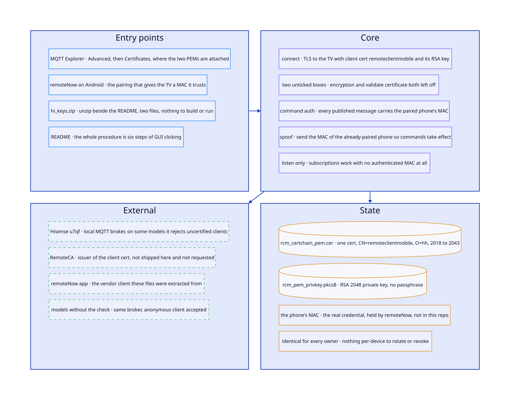

# Hisense-mqtt-keyfiles — the client certificate a Hisense TV wants before it will talk MQTT

Two PEM files lifted from the remoteNow Android app that let MQTT Explorer connect to a Hisense smart TV (`u7qf` and similar models) whose local broker refuses clients without a certificate.

## Read it left to right

- **These are not TV-specific keys.** One client certificate (`CN=remoteclientmobile, O=hh, OU=multiscreen`, issued by `RemoteCA` in 2018, valid to 2043) and one unencrypted RSA-2048 key, identical for every TV and every owner — which is exactly why publishing them costs nothing and why they cannot be a secret.
- **Connection and authorisation are two different locks.** The certificate gets you through the TLS door; the MAC address carried inside each published command is what decides whether the TV acts on it. The README's trick is to reuse the MAC of a phone that remoteNow has already paired, so the TV sees a known remote.
- **Listening is cheaper than commanding.** Topics can be subscribed and read without any authenticated MAC, so the interesting work — sniffing state, finding command shapes — needs the cert but not the pairing. Only writes need both.
- **Certificate validation is deliberately off.** The README ticks neither *Encryption* nor *Validate certificate* and says the server CA was not required; the zip contains no `RemoteCA` either. What you get is encryption without authentication, which is fine for a LAN experiment and worth knowing before reusing this anywhere else.
- **Not every model asks.** The check is model-dependent (the `u7qf` is the example), so on other sets the same broker accepts an anonymous client and this repo is unnecessary.

---

Diagram source: [`docs/system.d2`](docs/system.d2) · render with [`scripts/render-diagram.sh`](scripts/render-diagram.sh) (writes `docs/system.svg` for light and dark, plus `docs/system.png`).
